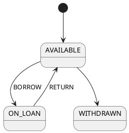

# Avouch Markdown convention 1

This document is the grammar of the built-in Markdown adapter (`src/markdown.ts`). The adapter reads facts only in the form that this document describes. A project has two ways to use Avouch with Markdown documents:

1. Write the documents to this convention. Then `avouch check` runs the built-in adapter, with a JSON configuration (`docs/adapter-guide.md` section 7).
2. Write an own adapter. Then the grammar of the documents is free. See `docs/adapter-guide.md` sections 1 to 6.

An AI that reformats documents can use this document as the target form. Write each fact as one block, as the templates in sections 3 to 10 show.

Version rule:

- The convention has a version: `1` in this document.
- The major number changes only when the grammar changes.
- A backward-compatible relaxation adds a minor number (`1.1`) and keeps the major number.
- The inventory file of `avouch facts --inventory` has the field `conventionVersion`. Its value is the convention version (now `1`). See `README.md`.

Not guaranteed: prose outside the blocks is not checked. The adapter does not read what a sentence says. The checker compares the blocks with the ontology only.

The block is the formal form of the fact. Do not state a different version of the same fact in prose.

The conventions are fixed in code, not in configuration.

## 1. Contents

| Section | Fact | Rule |
|---|---|---|
| 2 | General rules: text, fences, generated blocks, headings and anchors, diagnostics | all |
| 3 | Field list (`text` block) | R2, R6 |
| 4 | `storeCatalog` | R2 |
| 5 | `eventCatalog` | R8 |
| 6 | `permissions` (catalog block and table) | R10 |
| 7 | `contextMembers` | R5 |
| 8 | `scenarios` | R9 |
| 9 | `stateMachines` | R3 |
| 10 | `transitionTriggers` | R3 |
| 11 | Change table | |

The rule numbers are the rows of the table in `SPEC.md` section 5.

## 2. General rules

### 2.1 Text

- A leading byte order mark is removed.
- CRLF line ends become LF.

### 2.2 Fences and `text` blocks

- A line that starts, after at most three spaces, with n >= 3 backticks opens a fence.
- Only a line of n or more backticks (after at most three spaces) followed by nothing but white space closes the fence. A three-backtick line inside a four-backtick fence does not close it.
- `~~~` fences are not supported.
- An info string that contains backticks is not supported.
- A text block is a top-level fence whose info string is exactly `text`. Its body runs to its matching closing line.
- A text block inside another fence is body text. It is not a text block.
- A fence that is still open at the end of a document is an R2 diagnostic `markdown_fence` (key `doc:<path>`).

### 2.3 Generated blocks

- Outside fences, a line that, trimmed, starts with `<!-- BEGIN GENERATED` or `<!-- END GENERATED` is a marker.
- The marker must be `<!-- BEGIN GENERATED: <name><any note> -->` or `<!-- END GENERATED: <name> -->`. The name has letters, digits, `.`, `_` and `-`.
- The adapter removes each block with its marker lines before it reads any fact.
- A comment such as `<!-- GENERATED by a site tool -->` is not a marker.
- A malformed marker, a nested block, an END that does not match the open block, or a block still open at the end is an R2 diagnostic `markdown_generated_blocks` (key `doc:<path>`). The adapter then reads the document as it is.
- These diagnostics are R2. With R2 disabled they are dropped, and the adapter reads the raw text, generated content included. Do not disable R2 for a document with generated blocks.
- A pipe table does not run across a removed generated block.

### 2.4 Headings, sections and anchors

- A heading is an ATX heading, `#` to `######`, then a space and a title, outside fences.
- Setext headings and `{#id}` anchors are not supported.
- A section runs from its heading to the next heading of the same or a higher level. A section includes its subsections.
- Each heading has two anchors:
  - the short anchor: the first word of the title, without one trailing `.` (`## 3.2. Pricing` gives `3.2`; `## L1 Book` gives `L1`);
  - the full-title anchor: the whole title, without closing `#` characters (`## Open a rental` gives `Open a rental`).
- An anchor of two or more sections, in one document or across documents, is `"ambiguous"`. Give each cited heading a unique anchor. Rename a repeated heading first.
- A heading whose full title equals the first word of another heading also makes that anchor ambiguous. With `## Book` and `## Book details`, the anchor `Book` is ambiguous, and the one-word heading has no unique anchor. Rename one of them.
- An anchor of no section is `"missing"`.
- An anchor that starts with `§` and has no section as written is looked up again without the `§`. With `## 6.4 Pricing`, both `§6.4` and `6.4` find it.
- A heading whose anchor includes the `§` (`## §6.4 Pricing`) keeps it. `§6.4` finds that heading, and `6.4` finds a heading `## 6.4 ...`.
- The fallback adds no anchor, so an anchor stays unique.
- A fact keeps the anchor as configured or cited. An R10 cite must still equal the configured `facts.permissions` anchor exactly. `§6.4` and `6.4` are not equal.

### 2.5 Document terms

`containsTerm(term)`: the term as a whole identifier in any document, with generated blocks removed. The checker uses it to test whether an action id appears in the documents.

### 2.6 Diagnostics

- A configured anchor that is missing or ambiguous is a diagnostic of kind `markdown_anchor` under the rule of the fact. The key is `facts.<name>` (`facts.stateMachines.<Object>` for a state machine). The message is `anchor <anchor> of <key> is missing` or `anchor <anchor> of <key> is ambiguous`. The fact is still supplied, with an empty value. A state machine has the value `null`, so its graph is not compared.
- Any other parse problem is a diagnostic of kind `markdown_parse` with the same key. Sections 4 to 10 list them.
- A fence that is not closed: `markdown_fence`, message `<path>: a fence is not closed at the end of the document`.
- A generated-block problem: `markdown_generated_blocks`, message `<path>: ` and one of these:
  - `line <n>: malformed generated-block marker: <marker>`
  - `line <n>: generated block <name> opens inside <open>`
  - `line <n>: generated block end <name> does not close <open>` (or `an open block`)
  - `generated block <name> is not closed`
- A diagnostic fails the check like a violation.
- `avouch facts` prints each diagnostic as `DIAG <rule> <kind> <key>: <msg>`. The text under "Common errors" is `<msg>`.

Not guaranteed: the adapter reads only the state machines listed in `facts.stateMachines`. A state machine in a document that the configuration does not list is not checked.

## 3. Field list (`text` block)

### Purpose

R2 checks that each property of an object type is a field line of the field list (`property_not_field`), and that the section has one field list for the object (`field_list_missing`). R6 reads the same fields for its link checks (link effects, link catalog, non-link fields).

### Configuration

There is no entry in `facts`. The field `doc` of the object type in the ontology names the section (`objectTypes.<Object>.doc`).

### Template

````markdown
## <anchor> <Object>

```text
<Object>
- <field>
- <field>?
- <field_a> / <field_b>
- <field>   // comment
```
````

### Example

From `examples/library/library.md`:

````markdown
## L1 Book

A Book is one physical copy in the catalog.

```text
Book
- id
- branch_id
- title
- state
```

The title of a Book is set when the copy is catalogued.
The state of a Book is AVAILABLE, ON_LOAN or WITHDRAWN.
````

### Rules

- The section has exactly one `text` block whose first line, trimmed, is the object type. Another `text` block with a different first line is allowed. Not exactly one such block: the field list is `null`.
- Each `- <field>` line is a field. A line that does not start with `- ` is not a field.
- `- a / b` lists two fields (` / `: a space, a slash and a space).
- A comment (two slashes to the end of the line) is dropped.
- A trailing `?` marks the field nullable.
- A field that is listed twice is nullable when any of its lines is.

### Where prose goes

Put prose before or after the block, in the same section. Do not put prose in the block. A line in the block that is not a field line is ignored by the checker. For such a line that is not empty and not a `//` comment, `avouch facts` prints a `WARN` line.

### Common errors

| Error | Diagnostic |
|---|---|
| No `text` block with the object type as first line, or two such blocks | R2 `field_list_missing`: `<doc> has no single field list headed <Object>` |
| A property of the ontology has no field line | R2 `property_not_field`: `property <p> is not a field line (- <p>) of the <Object> field list in <doc>` |
| A line in the block is not a field line | `avouch facts` warning: `WARN <doc>:<line>: <anchor>#<first line>: line is not a field line: <text>` |
| Two blocks have the same section anchor and first line | `avouch facts` warning: `WARN <doc>:<line>: <anchor>#<first line>: another text block has the same section anchor and first line; this one is not in the fields` |

## 4. `storeCatalog`

### Purpose

R2 checks that each store name in the ontology is in the store catalog.

### Configuration

`facts.storeCatalog` is the anchor of the section that holds the catalog. In the toy library: `"storeCatalog": "L8"`.

### Template

````markdown
## <anchor> Stores

```text
<store>
<store>   // comment
<store_a> / <store_b>
```
````

### Example

From `examples/library/library.md`:

````markdown
## L8 Stores

```text
books
members
loans
branches
people
audit_log
```

Every action writes one row to audit_log.
````

### Rules

- The section has exactly one `text` block. A text block in a subsection counts toward that one.
- Each line is a list of names. The adapter removes the comment (two slashes to the end of the line) and trims the line. An empty line is skipped.
- ` / ` (a space, a slash and a space) separates names, as in a field list. Each name is trimmed: `a / b` is the names `a` and `b`.
- Any other `/` is part of a name: `a/b` is one name.
- A name is not empty and has no white space.

### Where prose goes

Put prose before or after the block, in the same section. Do not put prose in the block, because each line of the block is a list of names. Do not add a second `text` block to the section or to its subsections.

### Common errors

| Error | Diagnostic |
|---|---|
| Zero or two or more `text` blocks | R2 `markdown_parse` `facts.storeCatalog`: `facts.storeCatalog needs exactly one text code block in its section, found <n>` |
| An empty name or white space in a name (`a b`, `a / b /`, `a /  / b`) | R2 `markdown_parse` `facts.storeCatalog`: `facts.storeCatalog: catalog line has an empty name or white space in a name: <line>` |
| The anchor is missing or ambiguous | R2 `markdown_anchor` `facts.storeCatalog`: `anchor <anchor> of facts.storeCatalog is missing` (or `is ambiguous`) |

## 5. `eventCatalog`

### Purpose

R8 checks that each event that an action emits is in the event catalog.

### Configuration

`facts.eventCatalog` is the anchor of the section that holds the catalog. In the toy library: `"eventCatalog": "L9"`.

### Template

````markdown
## <anchor> Events

```text
<event>
<event>   // comment
<event_a> / <event_b>
```
````

### Example

From `examples/library/library.md`:

````markdown
## L9 Events

```text
loan.created
loan.returned
```
````

### Rules

- The section has exactly one `text` block. A text block in a subsection counts toward that one.
- Each line is a list of names. The adapter removes the comment (two slashes to the end of the line) and trims the line. An empty line is skipped.
- ` / ` (a space, a slash and a space) separates names. Each name is trimmed.
- Any other `/` is part of a name: `a/b` is one name.
- A name is not empty and has no white space.

### Where prose goes

Put prose before or after the block, in the same section. Do not put prose in the block. Do not add a second `text` block to the section or to its subsections.

### Common errors

| Error | Diagnostic |
|---|---|
| Zero or two or more `text` blocks | R8 `markdown_parse` `facts.eventCatalog`: `facts.eventCatalog needs exactly one text code block in its section, found <n>` |
| An empty name or white space in a name | R8 `markdown_parse` `facts.eventCatalog`: `facts.eventCatalog: catalog line has an empty name or white space in a name: <line>` |
| The anchor is missing or ambiguous | R8 `markdown_anchor` `facts.eventCatalog`: `anchor <anchor> of facts.eventCatalog is missing` (or `is ambiguous`) |

## 6. `permissions`

### Purpose

R10 checks that the permission keys of each action in the ontology equal the keys in the source row of the action, that each key is in the permission catalog, and that each permission cite names the configured section and quotes the row.

### Configuration

`facts.permissions` is the anchor of the section that holds the catalog block and the table. In the toy library: `"permissions": "L10"`. The configuration sets `requiredSource.R10` to this anchor. A permission cite in the ontology must name this anchor exactly.

### Template

````markdown
## <anchor> Permissions

```text
<permission key>
<permission key>   // comment
```

| Action | Keys |
|---|---|
| <ACTION_ID> | `<permission key>` |
| <ACTION_ID>, <ACTION_ID> | `<permission key>`, `<permission key>` |
````

### Example

From `examples/library/library.md`:

````markdown
## L10 Permissions

```text
loan:create
loan:close
```

| Action | Keys |
|---|---|
| BORROW | `loan:create` |
| RETURN | `loan:close` |
````

### Rules

Catalog block:

- The section has exactly one `text` block. A text block in a subsection counts toward that one.
- Each line is a list of names, with the same rules as the store catalog (section 4).

Table:

- The section has exactly one pipe table outside fences. A pipe table line starts with `|`.
- The adapter drops the alignment row. A data row made only of dashes, such as `| - | - |`, is read as an alignment row and dropped.
- The trailing `|` is optional.
- `\|` and a `|` inside a code span do not split cells.
- The header has two columns. The text of the header is free.
- Each data row has two cells.
- The first cell lists the row names, split on `,` and on `、` (U+3001).
- The keys are the code spans in the second cell. The second cell is the row text.
- A row name is listed once. If a name is listed twice, the first row is kept.
- A quote names a key when it contains the key in backticks.
- A permission cite must name the configured `facts.permissions` anchor exactly. A full-title anchor of the same section fails.

### Where prose goes

Put prose before or after the block and the table, in the same section. Do not put prose in the catalog block. Do not start a prose line with `|`, because the adapter reads it as a table row.

### Common errors

| Error | Diagnostic |
|---|---|
| Zero or two or more `text` blocks | R10 `markdown_parse` `facts.permissions`: `facts.permissions needs exactly one text code block in its section, found <n>` |
| An empty name or white space in a name of the catalog | R10 `markdown_parse` `facts.permissions`: `facts.permissions: catalog line has an empty name or white space in a name: <line>` |
| Zero or two or more tables | R10 `markdown_parse` `facts.permissions`: `facts.permissions needs exactly one pipe table in its section, found <n>` |
| The header does not have two columns | R10 `markdown_parse` `facts.permissions`: `facts.permissions: the table header has <n> columns, expected 2` |
| A row does not have two cells | R10 `markdown_parse` `facts.permissions`: `facts.permissions: row has <n> columns, expected 2: <cells joined by " \| ">` |
| A row name is listed twice | R10 `markdown_parse` `facts.permissions`: `facts.permissions: row <name> is listed more than once; the first row is kept` |
| The anchor is missing or ambiguous | R10 `markdown_anchor` `facts.permissions`: `anchor <anchor> of facts.permissions is missing` (or `is ambiguous`) |
| A permission cite names the full-title anchor, or a different anchor, or quotes text that is not in the row | R10 `permission_cite_mismatch`: `permission cite must quote the <ID> row of the source permission table` |

## 7. `contextMembers`

### Purpose

R5 checks that the context of each object type in the ontology is the context that the source gives it, and that each entity that the source lists is an object type or is declared out of scope.

### Configuration

`facts.contextMembers` is the anchor of the section that holds the lines. In the toy library: `"contextMembers": "L7"`.

### Template

````markdown
## <anchor> Contexts

- <Context>: <Object>, <Object>
- <Context>: <Object>
````

### Example

From `examples/library/library.md`:

````markdown
## L7 Contexts

- Catalog: Book
- Circulation: Member, Loan, Branch, Person
````

### Rules

- Each line `- <context>: <member>, <member>` outside fences is one context. The line starts with `- ` at the start of the line.
- The context is the text before the first `:`, trimmed. The members are split on `,` and trimmed. An empty member is dropped.
- A context is listed once.
- The section has at least one such line.

### Where prose goes

Put prose before or after the lines, in the same section. Do not put prose in a line. Do not start a prose line with `- <text>: `, because the adapter reads it as a context line.

### Common errors

| Error | Diagnostic |
|---|---|
| No context line | R5 `markdown_parse` `facts.contextMembers`: ``facts.contextMembers: the section has no `- <context>: <members>` line`` |
| A context is listed twice | R5 `markdown_parse` `facts.contextMembers`: `facts.contextMembers: context <context> is listed more than once` |
| The anchor is missing or ambiguous | R5 `markdown_anchor` `facts.contextMembers`: `anchor <anchor> of facts.contextMembers is missing` (or `is ambiguous`) |

## 8. `scenarios`

### Purpose

R9 checks that every scenario that an action lists exists, that the scenario cites the action, and that every action is cited by a scenario.

### Configuration

`facts.scenarios` is the anchor of the section that holds the scenario lines. In the toy library: `"scenarios": "L11"`. Without this entry, R9 is off.

### Template

````markdown
## <anchor> Scenarios

- <id>: <text> (<ACTION_ID>).
- <id>: <text> (<ACTION_ID>, <ACTION_ID>).
````

### Example

From `examples/library/library.md`:

````markdown
## L11 Scenarios

- S1: a member borrows an AVAILABLE book (BORROW).
- S2: a member returns a book (RETURN).
````

### Rules

- Each line `- <id>: <text>` outside fences in the section is one scenario.
- The id is one word, without white space, before the first `: `. A line such as `- Happy path: ...` is not a scenario.
- The scenario cites the action ids in the last bracket pair at the end of the line. The adapter removes white space and one trailing `.` or `。`. Then it reads the text inside a closing `(...)` or `（...）` (the two brackets of the same kind), splits it on `,` and `，`, and trims each item.
- `- S1: an AVAILABLE book (BORROW).` cites `BORROW` only. Other upper-case words in the text are not cited.
- A line without a closing bracket pair cites nothing.
- Put only action ids in that last bracket pair. `- S1: borrow a book (members only).` is an error.
- An action id cannot contain a bracket.
- Each item must match `actionIdPattern`. An item that does not match is not cited.
- A scenario id is listed once. If an id is listed twice, the first line is kept.
- The section has at least one scenario line.

### Where prose goes

Put prose before or after the lines, in the same section. Do not put prose in a scenario line after the last bracket pair. Do not start a prose line with `- <word>: `, because the adapter reads it as a scenario.

### Common errors

| Error | Diagnostic |
|---|---|
| An item in the last bracket pair does not match `actionIdPattern` (for example `members only`) | R9 `markdown_parse` `facts.scenarios`: `facts.scenarios: scenario <id> cites "<item>", which does not match actionIdPattern` |
| A scenario id is listed twice | R9 `markdown_parse` `facts.scenarios`: `facts.scenarios: scenario <id> is listed more than once; the first is kept` |
| No scenario line | R9 `markdown_parse` `facts.scenarios`: ``facts.scenarios: the section has no `- <id>: <text> (<action>, ...)` line`` |
| The anchor is missing or ambiguous | R9 `markdown_anchor` `facts.scenarios`: `anchor <anchor> of facts.scenarios is missing` (or `is ambiguous`) |

## 9. `stateMachines`

### Purpose

R3 checks that the state graph of each object type in the ontology equals the state diagram in the source: states, initial states and edges.

### Configuration

`facts.stateMachines` is an object. Each key is an object type, and each value is the anchor of the section that holds the state diagram of that object. In the toy library: `"stateMachines": {"Book": "L4", "Loan": "L5"}`. Set `facts.stateMachines` and `facts.transitionTriggers` together or not at all. Without them, R3 is off.

### Template

````markdown
## <anchor> <Object> State

```plantuml
@startuml
[*] --> <INITIAL_STATE>
<STATE_A> --> <STATE_B> : <ACTION_ID>
<STATE_B> --> <STATE_C>
@enduml
```
````

### Example

From `examples/library/library.md`:

````markdown
## L4 Book State



A librarian withdraws a copy outside the system.
````

### Rules

- For each configured object type, the section has exactly one state diagram block. It is a top-level fence whose info string is `plantuml`. It can also be a fence whose info string is `mermaid` and whose first line that is not empty and not a `%%` comment is `stateDiagram` or `stateDiagram-v2`.
- Each body line, trimmed, is one of the forms below. Any other line is an error. Examples of other lines: `state X {`, `A -> B`, `state "x" as X`, a `<<choice>>` state.
- These lines are ignored:
  - an empty line;
  - `@startuml`, `@enduml`, `stateDiagram`, `stateDiagram-v2`;
  - a line that starts with `'` or `%%`;
  - a line that starts with `hide `, `skinparam `, `title ` or `direction `;
  - a one-line note (`note ` ... `:` ...);
  - a note block. It runs from a line `note left of <state>` (or `right`, `top`, `bottom`) to a line `end note`.
- Any other line that starts with `note `, for example `note "x" as N1`, is outside the grammar.
- An edge is `<from> --> <to>` or `<from> --> <to> : <label>`. The spaces around `-->` and before `:` are optional, so `A-->B` and the mermaid form `A --> B: label` are edges.
- `<from>` and `<to>` are `[*]` or a name of letters, digits and `_` that does not start with a digit.
- `[*] --> X` makes X an initial state and a state.
- `X --> [*]` makes X a state and no edge.
- `A --> B` makes A and B states and the edge `A->B`. An edge that is listed twice is kept once.
- The value is `{nodes, initial, edges}`. Each list is in the order of first appearance. The fact has one entry for each configured object type, with the configured anchor as its source.
- The adapter reads only the state machines listed in `facts.stateMachines`. A state machine in a document that the configuration does not list is not checked.

### Where prose goes

Put prose before or after the diagram, in the same section. Do not put prose in the diagram, except as a `note`. Do not add a second `plantuml` block, or a second `mermaid` state diagram block, to the section or to its subsections.

### Common errors

All diagnostics are rule R3, kind `markdown_parse`, key `facts.stateMachines.<Object>`. The value of the state machine is `null`.

| Error | Diagnostic |
|---|---|
| Zero or two or more state diagram blocks | `facts.stateMachines.<Object> needs exactly one state diagram block (plantuml, or mermaid stateDiagram) in its section, found <n>` |
| A line outside the grammar | `state diagram line is outside the grammar: <line>` |
| A note block without `end note` | ``state diagram: a `note` block is not closed by `end note` `` |
| The anchor is missing or ambiguous (kind `markdown_anchor`) | `anchor <anchor> of facts.stateMachines.<Object> is missing` (or `is ambiguous`) |

## 10. `transitionTriggers`

### Purpose

R3 checks that the `by` list of each transition in the ontology equals the triggers in the source table.

### Configuration

`facts.transitionTriggers` is the anchor of the section that holds the table. In the toy library: `"transitionTriggers": "L6"`. Set it together with `facts.stateMachines`.

### Template

````markdown
## <anchor> Actions

| Object | Transition | Trigger |
|---|---|---|
| <Object> | <STATE_A> → <STATE_B> | <ACTION_ID> |
| <Object> | <STATE_A> / <STATE_B> → <STATE_C>, <STATE_C> → <STATE_A> | <ACTION_ID>, <ACTION_ID> |
````

### Example

From `examples/library/library.md`:

````markdown
## L6 Actions

| Object | Transition | Trigger |
|---|---|---|
| Book | AVAILABLE → ON_LOAN | BORROW |
| Book | ON_LOAN → AVAILABLE | RETURN |
| Loan | ACTIVE → RETURNED | RETURN |

BORROW creates a Loan for an AVAILABLE Book and a Member who is not blocked.
RETURN closes an ACTIVE Loan and makes the Book AVAILABLE again.
BORROW and RETURN write Book and Member in the same transaction as the Loan.
BORROW takes member_id, the Member who borrows; only that Member may submit BORROW.
BORROW takes book_id, the Book to lend.
RETURN takes loan_id, the Loan to close.
BORROW and RETURN check their rules from top to bottom; the first rule that matches decides.
BORROW by anyone other than that Member is REJECTED. BORROW of a Book that is not AVAILABLE is REJECTED. BORROW by a blocked Member is REJECTED. BORROW by a Member with a Loan that is not returned in GOOD condition is REFERRED to a librarian. Otherwise BORROW is BORROWED.
RETURN of a Loan that is not ACTIVE is REJECTED. RETURN after the due_date, on the date of the Branch timezone, is RETURNED_LATE. Otherwise RETURN is RETURNED.
The caller of an action is a Person.
<!-- BEGIN GENERATED: action-summary -->
Generated from the ontology: BORROW edits Book.state and Member.open_loans.
<!-- END GENERATED: action-summary -->
````

The generated block is removed before the adapter reads the section (section 2.3).

### Rules

- The section has exactly one pipe table outside fences, with the table rules of section 6 (alignment row, optional trailing `|`, `\|`).
- The header has exactly three columns: object, transition, trigger. The text of the header is free.
- Each data row has three cells. A row with another number of cells is skipped.
- The object is the first cell, trimmed. It must be a key of `facts.stateMachines`. Else the row binds nothing.
- The transition cell is a list split on `,` and `，`. Each item is `<state> → <state>` or `<state> -> <state>`. Each side can list states with ` / `: `PENDING / ACCEPTED → STARTED` is the edges `PENDING->STARTED` and `ACCEPTED->STARTED`.
- The trigger cell is a list of action ids split on `,` and `，`. Each item must match `actionIdPattern`.
- An item that does not fit is an error, and the whole row binds nothing.
- When two rows give the same object and edge, the triggers are joined.
- The adapter does not read the ontology, so it keeps a trigger that the ontology does not declare. R3 reports it.

### Where prose goes

Put prose before or after the table, in the same section. Do not put prose in a cell. Do not start a prose line with `|`, because the adapter reads it as a table row.

### Common errors

All diagnostics are rule R3, kind `markdown_parse`, key `facts.transitionTriggers`.

| Error | Diagnostic |
|---|---|
| Zero or two or more tables | `facts.transitionTriggers needs exactly one pipe table in its section, found <n>` |
| The header does not have three columns | `facts.transitionTriggers: the table header has <n> columns, expected 3` |
| A row does not have three cells | `facts.transitionTriggers: row has <n> columns, expected 3: <cells joined by " \| ">` |
| The object is not a key of `facts.stateMachines` | `facts.transitionTriggers: object "<object>" is not a key of facts.stateMachines: <cells joined by " \| ">` |
| An item of the transition cell is not a transition | ``facts.transitionTriggers: "<item>" is not a transition `<state> → <state>` `` |
| A trigger does not match `actionIdPattern` | `facts.transitionTriggers: trigger "<item>" does not match actionIdPattern` |
| The anchor is missing or ambiguous (kind `markdown_anchor`) | `anchor <anchor> of facts.transitionTriggers is missing` (or `is ambiguous`) |

## 11. Change table

| Convention version | Package version | Change |
|---|---|---|
| 1 | 0.1.21 | First published form. The grammar is the one that `src/markdown.ts` reads. |
